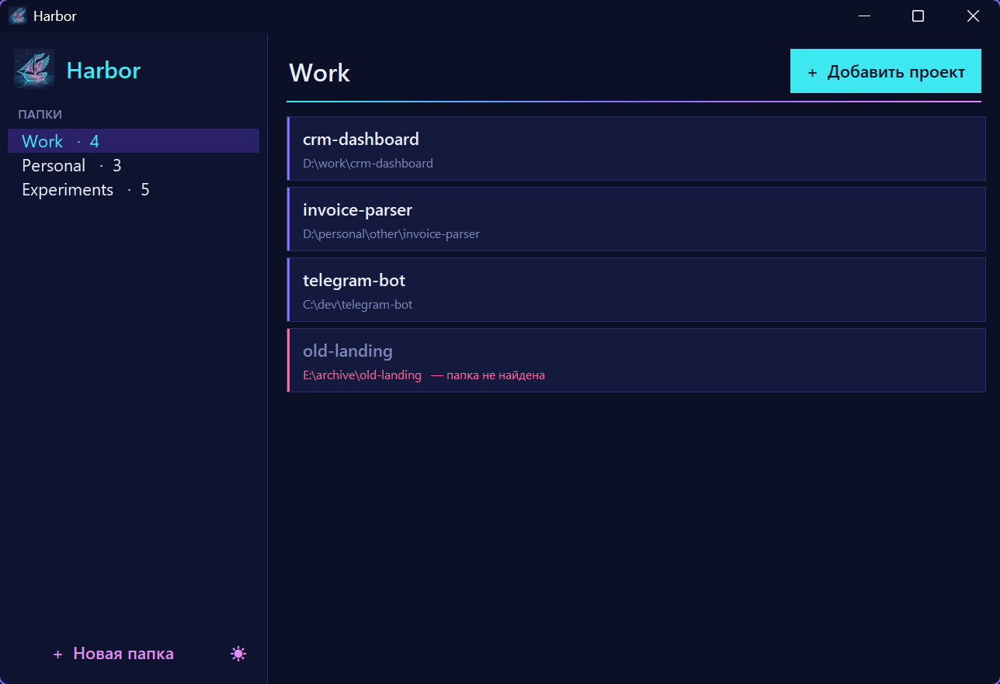

<p align="center">
  
</p>

<h1 align="center">Harbor</h1>

<p align="center">
  A tiny neon launcher that keeps all your projects in one place and opens them in VS Code with a single click.
  <br>
  <b>English</b> · <a href="README.ru.md">Русский</a>
</p>

<p align="center">
  
</p>

## Why

When you build a lot of small projects, they end up scattered across the disk:
`D:\work\...`, `D:\personal\other\...`, `C:\dev\...`. Opening the right one means digging through Explorer every time.

Harbor gives you **your own folder structure** that doesn't depend on where the projects actually live.
Group them any way you like, for example *Work*, *Personal* or *Experiments*, and click a project to open it in VS Code.

## Features

- **Custom groups.** Create, rename and delete folders that exist only in Harbor.
- **One-click open.** A click on a project opens its folder in VS Code. The Python extension then picks up the project's own `venv`.
- **Add any folder.** Press **+ Add project** and choose a directory anywhere on your disk.
- **Right-click menu.** Show the project in Explorer, rename it, change its path, move it to another group or remove it from the list.
- **Missing folders are highlighted.** A project whose folder was moved or deleted is marked in red.
- **Safe.** Removing a group or project never touches the files on disk.
- **No dependencies.** Harbor uses only the Python standard library (tkinter).
- **Dark and light theme.** Switch with the ☀ / ☾ button in the sidebar. The first launch follows the Windows theme.


## Requirements

- Windows 10 or 11
- Python 3.8+ with tkinter (included in the standard installer from python.org)
- [Visual Studio Code](https://code.visualstudio.com/)

## Installation

```powershell
git clone https://github.com/veilaris/harbor.git
cd harbor
powershell -ExecutionPolicy Bypass -File install_shortcut.ps1
```

This puts a **Harbor** shortcut on your desktop. You can also start the app directly:

```powershell
pythonw harbor.pyw
```

## How it works

| Piece | What it does |
|---|---|
| `harbor.pyw` | The whole app, a single tkinter file. `.pyw` runs without a console window. |
| `harbor.json` | Your groups and projects, created next to the script on first use. It is excluded from git. |
| `install_shortcut.ps1` | Creates the desktop shortcut with the Harbor icon. |

Harbor finds VS Code through `code` in `PATH` or the standard install locations and launches `Code.exe` directly, so no console window flashes.

## License

[MIT](LICENSE)
