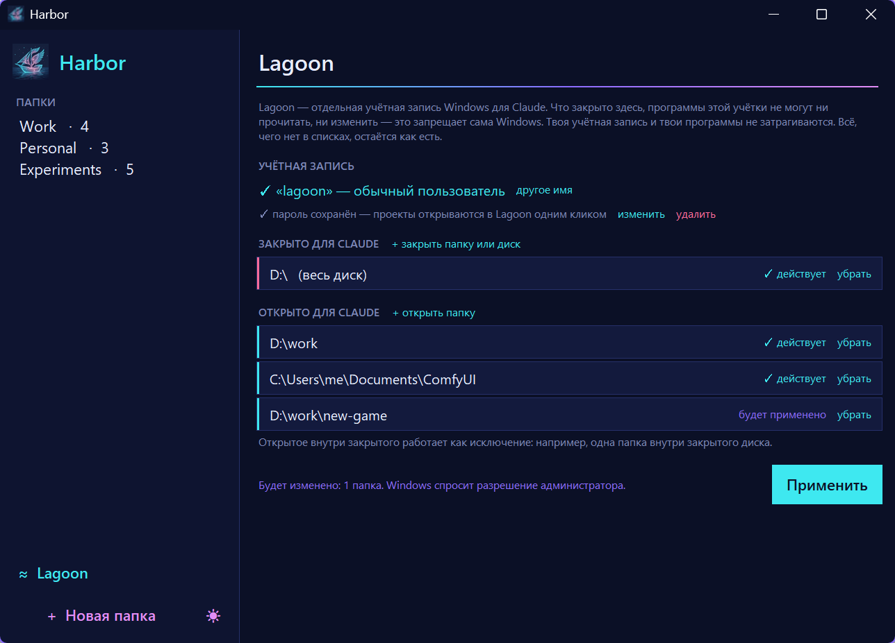

<h1 align="center">Harbor</h1>

<p align="center">
  A lightweight launcher for VS Code projects: keeps all your projects in one place and opens them with a single click.
  <br>
  <b>English</b> · <a href="README.ru.md">Русский</a>
</p>

<p align="center">
  
</p>

## Why

When you build a lot of small projects, they end up scattered across the disk:
`D:\work\...`, `D:\personal\other\...`, `C:\dev\...`. Opening the right one means digging through Explorer every time.

Harbor gives you **your own folder structure** that doesn't depend on where the projects actually live.
Group them any way you like, for example *Work*, *Personal* or *Experiments*, and click a project to open it in VS Code.

## Features

- **Custom groups.** Create, rename and delete folders that exist only in Harbor.
- **One-click open.** A click on a project opens its folder in VS Code. The Python extension then picks up the project's own `venv`.
- **Add any folder.** Press **+ Add project** and choose a directory anywhere on your disk.
- **Right-click menu.** Show the project in Explorer, rename it, change its path, move it to another group or remove it from the list.
- **Missing folders are highlighted.** A project whose folder was moved or deleted is marked in red.
- **Safe.** Removing a group or project never touches the files on disk.
- **No dependencies.** Harbor uses only the Python standard library (tkinter).
- **Dark and light theme.** Switch with the ☀ / ☾ button in the sidebar. The first launch follows the Windows theme.
- **Lagoon, a space for Claude.** Claude Code works without permission prompts but can't see your personal files. See [below](#lagoon-claude-without-prompts-without-access-to-your-files).

## Lagoon: Claude without prompts, without access to your files

Claude Code is most convenient in the mode where it never asks: it installs libraries, runs commands and digs through programs on its own. But in that mode it can read everything your Windows account can read: documents, messenger data, saved browser sessions. Claude's own permission settings don't fully prevent that, because shell commands go around them.

Lagoon solves this with Windows itself. Claude runs under a **separate Windows account**, and Windows refuses that account access to the folders you closed, no matter what the program tries.

<p align="center">
  
</p>

### Setup (once)

1. **Create a standard Windows account**, for example `lagoon`: Settings → Accounts → Other users. Account type "Standard user", with a password. It must not be an administrator: an administrator can remove any restriction.
2. **Sign in to it once** and install VS Code with the Claude Code extension. In VS Code settings, turn on `claudeCode.allowDangerouslySkipPermissions` and set `claudeCode.initialPermissionMode` to `bypassPermissions`. This only affects that account's VS Code, not yours. Then sign out; you won't need to sign in again.
3. **Open the ≈ Lagoon screen in Harbor.** Close what Claude must not see (for example, the whole `D:\` drive), open the exceptions (project folders, ComfyUI) and press **Apply**. Windows asks for administrator permission once.

### Daily use

- **Clicking a project** opens VS Code as Lagoon right on your desktop, if the project folder is open to it. The **≈ Lagoon** badge on the card shows this.
- **Projects in closed locations** open in your own VS Code (badge "from my account"), where Claude asks for permissions as usual. Right-click a project to switch between Lagoon and your own account.
- **The Lagoon password** is entered once. Harbor keeps it in Windows Credential Manager, encrypted and available only to your own account.

### How it works

- **Closing or opening a folder** adds a deny or allow rule for the Lagoon account to that folder's permissions (`icacls`). A rule on a subfolder takes priority over the one on the drive, so "close the whole drive, open one folder" works. Your own account and your programs are not affected.
- **The lists on the screen** are built from the folders' real permissions, not from Harbor's memory, so changes made by hand in a folder's properties show up too.
- **System folders** (`Windows`, `Program Files`, `ProgramData`, the `C:\` drive itself) can't be closed: without them the Lagoon account can't run programs.

### Limitations

- **Files are protected, the screen is not.** Lagoon's VS Code runs on your desktop, so technically it can see the screen and clipboard and send keystrokes to other windows. Claude won't do that by accident, but it is not a wall.
- **Programs installed only for your account** (in `AppData`) are not available to Lagoon. If Claude needs them, install them in the Lagoon account too.
- **Claude conversations** are stored in the profile of the account Claude ran under. Old conversations from your profile can be copied to Lagoon's profile (`C:\Users\<lagoon>\.claude\projects`) with administrator rights.

## Requirements

- Windows 10 or 11
- Python 3.8+ with tkinter (included in the standard installer from python.org)
- [Visual Studio Code](https://code.visualstudio.com/)

## Installation

```powershell
git clone https://github.com/veilaris/harbor.git
cd harbor
powershell -ExecutionPolicy Bypass -File install_shortcut.ps1
```

This puts a **Harbor** shortcut on your desktop. You can also start the app directly:

```powershell
pythonw harbor.pyw
```

## How it works

| Piece | What it does |
|---|---|
| `harbor.pyw` | The whole app, a single tkinter file. `.pyw` runs without a console window. |
| `harbor.json` | Your groups, projects and Lagoon lists, created next to the script on first use. It is excluded from git. |
| `install_shortcut.ps1` | Creates the desktop shortcut with the Harbor icon. |

Harbor finds VS Code through `code` in `PATH` or the standard install locations and launches `Code.exe` directly, so no console window flashes.

## License

[MIT](LICENSE)
