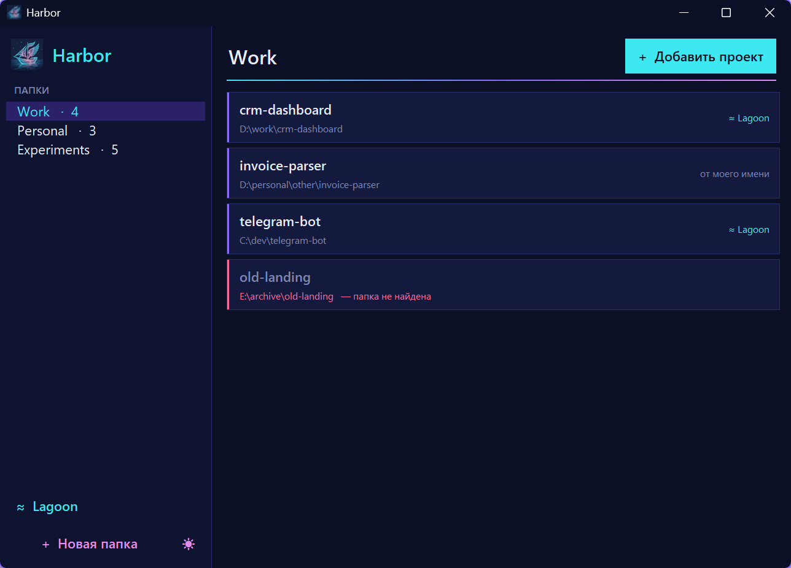

<h1 align="center">Harbor</h1>

<p align="center">
  Легкий лаунчер для VSCode проектов: все проекты в одном окне, открываются в VS Code одним кликом.
  <br>
  <a href="README.md">English</a> · <b>Русский</b>
</p>

<p align="center">
  
</p>

## Зачем

Когда проектов много, они расползаются по диску:
`D:\work\...`, `D:\personal\other\...`, `C:\dev\...`. Чтобы открыть нужный, каждый раз приходится лезть в проводник.

В Harbor **своя структура папок**, которая не зависит от того, где проекты лежат на самом деле.
Группируй как удобно, например «Работа», «Личное» или «Эксперименты», и открывай проект кликом.

## Возможности

- **Свои папки.** Их можно создавать, переименовывать и удалять. Существуют они только внутри Harbor.
- **Открытие в один клик.** Клик по проекту открывает его папку в VS Code, а расширение Python подхватывает `venv` проекта.
- **Любая папка с диска.** Кнопка **+ Добавить проект** открывает выбор директории.
- **Меню по правому клику.** Можно показать проект в проводнике, переименовать, сменить путь, перенести в другую папку или убрать из списка.
- **Подсветка пропавших проектов.** Если папку проекта переместили или удалили, он отмечается красным.
- **Безопасно.** Удаление папки или проекта из Harbor не трогает файлы на диске.
- **Без зависимостей.** Нужна только стандартная библиотека Python (tkinter).
- **Тёмная и светлая тема.** Переключаются кнопкой ☀ / ☾ в боковой панели. При первом запуске берётся тема Windows.


## Требования

- Windows 10 или 11
- Python 3.8+ с tkinter (входит в стандартный установщик с python.org)
- [Visual Studio Code](https://code.visualstudio.com/)

## Установка

```powershell
git clone https://github.com/veilaris/harbor.git
cd harbor
powershell -ExecutionPolicy Bypass -File install_shortcut.ps1
```

На рабочем столе появится ярлык **Harbor**. Можно запустить и напрямую:

```powershell
pythonw harbor.pyw
```

## Как устроено

| Файл | Что делает |
|---|---|
| `harbor.pyw` | Всё приложение в одном файле на tkinter. `.pyw` запускается без консольного окна. |
| `harbor.json` | Твои папки и проекты. Создаётся рядом со скриптом при первом использовании и не попадает в git. |
| `install_shortcut.ps1` | Создаёт ярлык на рабочем столе с иконкой Harbor. |

VS Code ищется через `code` в `PATH` или в стандартных местах установки. Harbor запускает `Code.exe` напрямую, поэтому консольное окно не мелькает.

## Лицензия

[MIT](LICENSE)
